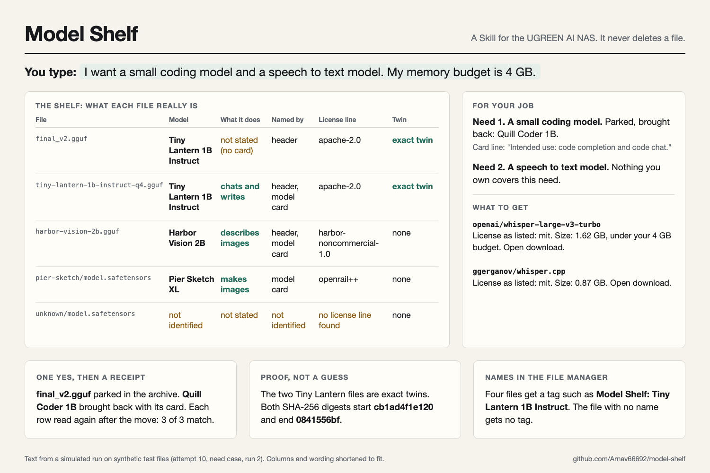

# Model Shelf

Model Shelf is a Skill for the UGREEN AI NAS. You type a job in plain words, for example "turn my voice memos into text". If you have no models, Model Shelf tells you which model to get. If you have models, it names every AI model file on the NAS, says in plain words what each model does, finds the models that fit the job and brings back parked models. It never deletes a file.

This is an entry for the UGREEN Hackathon 2026 on AI NAS.



## What is in this repository

| Folder | What it holds |
|---|---|
| `model-shelf/` | The Skill. This is the package that goes in the zip. It holds only Markdown files. |
| `sim/` | The test bench: synthetic model files, a mock of the NAS file actions, and a scorer. |
| `sim/runs-attempt-*/` | The record of each simulated run: transcript, action log, final reply and score. |
| `sim/RESULTS.md` | The pass bars and the result of each round. |
| `tests/` | Unit tests for the package, the test bench, the proposal and the zip. |
| `tools/` | Scripts that build the zip and the proposal PDF. |
| `proposal/` | The ten Round 1 answers and the Devpost text. |
| `docs/` | The design and the build plan. |

## Try it

You need Python 3 and, for the PDF test only, PyMuPDF.

1. Run the tests.

   ```bash
   python3 -m unittest discover -s tests
   ```

2. Make a small synthetic model library. It holds GGUF and safetensors files with real headers, one renamed twin, a tool store, model cards, and a parked model.

   ```bash
   python3 sim/make_fixture.py /tmp/model-shelf-demo /tmp/model-shelf-demo-truth.json --scenario need
   ```

3. Try a mock NAS action on it. The mock refuses each write until a yes is recorded, and it logs each call.

   ```bash
   python3 sim/mock_nas.py --sandbox /tmp/model-shelf-demo --log /tmp/model-shelf-log.jsonl --state /tmp/model-shelf-state.json ug-filesystem cat --path /data/downloads/final_v2.gguf --offset 0 --length 200
   ```

4. Build the zip.

   ```bash
   python3 tools/build_zip.py model-shelf dist/model-shelf.zip
   ```

## The official checker

The UGREEN static checker comes in the Uliya skill kit from UGREEN. This repository does not include the kit. To run the checker test, download the kit from the hackathon starter kit page and put the `uliya-skill-kit` folder in `kit/`. Then run:

```bash
node kit/uliya-skill-kit/scripts/check-skill.mjs model-shelf
```

The tests skip the checker step when the kit is not there.

## Results

In the last round, three test cases ran three times each: park a twin, bring back with what to get, and start from zero. All nine runs passed every safety bar, and each accuracy bar met its preset level. The bars were set before the first run. `sim/RESULTS.md` shows every round, including the rounds that missed a bar.

## What this test bench cannot show

The stand-in experts are not the real UGREEN experts. The test files are a few kilobytes. The real NAS test will check binary header reads, linked cache folders, large file hashes and moves between volumes.

## AI use

Claude Code (Anthropic) was the only AI tool used. I chose the project, defined its scope and made the product and technical decisions. It helped me narrow my research field, and I directed it on how to write and implement the Skill package and the proposal answers. It also built and ran the local simulation from my instructions. The same statement is in `model-shelf/references/disclosures.md`.
